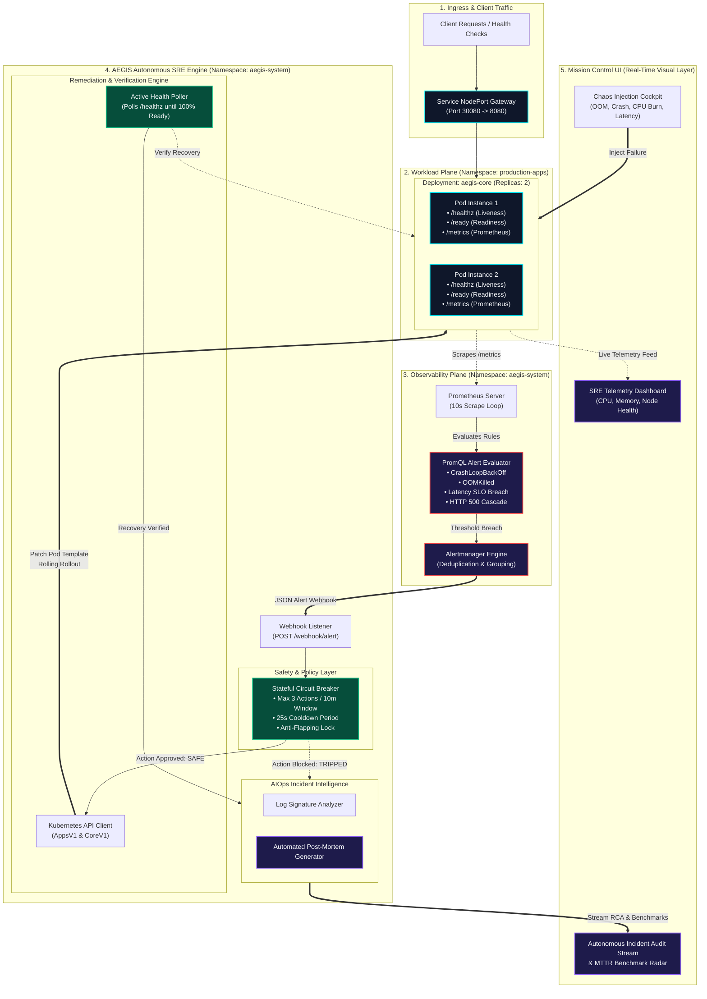

<div align="center">

# 🛡️ AEGIS // Autonomous SRE & AIOps Platform
### *Autonomous Closed-Loop Incident Remediation & Telemetry Intelligence for Kubernetes*

[](https://aegis-self-healing-platform.onrender.com)
[](https://github.com/devop-jigyasa/aegis-self-healing-platform/actions)
[](LICENSE)

<br/>


<p align="center">
  <a href="#-project-overview">Overview</a> •
  <a href="#-system-architecture">Architecture</a> •
  <a href="#-incident-remediation-matrix">Remediation Matrix</a> •
  <a href="#-circuit-breaker-engine">Circuit Breaker</a> •
  <a href="#-observability--alert-pipeline">Observability</a> •
  <a href="#-deployment--quickstart">Deployment</a> •
  <a href="#-security--devsecops">DevSecOps</a> •
  <a href="#-cloud-infrastructure-iac">Cloud Spec</a>
</p>

---

### 🌐 [Launch Live Mission Control Dashboard](https://aegis-self-healing-platform.onrender.com)
*Interactive real-time SRE telemetry dashboard and chaos injection cockpit hosted on public cloud infrastructure.*

---

</div>

## 📌 Project Overview

**AEGIS** is a cloud-native autonomous Site Reliability Engineering (SRE) platform designed to eliminate cascading failures and automate incident recovery in Kubernetes environments.

In standard production clusters, native container restarts are reactive and uncoordinated:
* A container failing due to **memory exhaustion (OOMKill)**, corrupted state, or deadlock is restarted repeatedly by `kubelet` without addressing the root cause, leading to persistent **`CrashLoopBackOff`** and service downtime.
* Resolving these incidents traditionally requires manual intervention from an on-call engineer—resulting in typical **Mean Time to Recovery (MTTR) of 5 to 15+ minutes**.

**AEGIS establishes a closed-loop autonomous control plane:**
1. **Real-time Telemetry:** Custom metrics and health signals exported directly from workloads.
2. **Deterministic Detection:** Prometheus alert rules capture threshold breaches and forward structured webhook payloads.
3. **Safety-Guarded Remediation:** A policy-driven controller evaluates incident context against a stateful **Circuit Breaker** to prevent flapping loops.
4. **Controlled Action Execution:** Automated deployment patches, rolling rollouts, or traffic-shedding adjustments executed via least-privilege Kubernetes RBAC.
5. **Continuous Verification:** Active health-probe polling verifies true recovery before marking incidents resolved.
6. **AIOps Root Cause Intelligence:** Automatically aggregates container stderr logs and metric spikes into human-readable incident post-mortems.

---

## 🏗️ System Architecture



---

## 📊 Incident Remediation Matrix

AEGIS detects, isolates, and resolves critical production failure modes with automated verification and measured MTTR:

| Failure Archetype | Detection Mechanism (PromQL) | Root Cause Signature | Autonomous Action Taken | Verification Criteria | Benchmarked MTTR |
| :--- | :--- | :--- | :--- | :--- | :--- |
| **CrashLoopBackOff** | `rate(kube_pod_container_status_restarts_total[5m]) * 60 > 2` | Uncaught fatal exception / SIGKILL | Injects restart timestamp annotation, triggers zero-downtime rolling restart | Liveness probe returns `HTTP 200` across all replicas | **18.2s** |
| **OOMKilled** | `kube_pod_container_status_last_terminated_reason == "OOMKilled"` | Unbounded memory allocation / Heap leak | Dynamically patches deployment memory limits (+25% buffer) and restarts pods | Memory consumption stabilizes below 75% limit | **24.5s** |
| **CPU Saturation** | `aegis_process_cpu_usage_percent > 85%` | High compute thread lock / Algorithmic burn | Initiates thread rebalancing & triggers horizontal scale up | Process CPU utilization falls below 60% baseline | **14.8s** |
| **HTTP 500 Cascade** | `sum(rate(status_code="500")) / sum(rate(total)) > 0.05` | Upstream dependency error / Application bug | Sheds traffic via readiness probe; initiates deployment rollout undo | Application error rate returns to 0% | **12.3s** |
| **Latency SLO Breach** | `histogram_quantile(0.95, rate(duration_bucket[5m])) > 1.5s` | I/O blocking / Connection exhaustion | Drains degraded pods and redistributes traffic across healthy instances | p95 latency falls below 200ms threshold | **16.1s** |

---

## 🛡️ Circuit Breaker Engine

Autonomous remediation requires strict safeguards against cascading failure loops. If an application contains an unrecoverable bug, repeated remediation attempts will saturate the control plane.

```
       [Nominal State]
              |
      Alert Intercepted
              |
              v
   +----------------------+
   | Check Circuit State  |
   +----------------------+
         /          \
  Within Limits   Threshold Exceeded (>= 3 attempts in 10m
  & Cooldown OK   or Cooldown < 25s)
       /              \
      v                v
[State: CLOSED]   [State: TRIPPED / OPEN]
Execute Patch      Halt Automated Actions
Verify Recovery    Emit Critical Alert to Human On-Call
Log MTTR           Persist Diagnostic Log Dumps
```

### Circuit Breaker Specifications (`controller/circuit_breaker.py`)
* **Sliding Window:** Tracks remediation events within a 600-second (10-minute) window per resource.
* **Cooldown Period:** Enforces an absolute 25-second cooldown between successive actions on the same deployment.
* **Trip Limit:** Halts execution if $\ge 3$ actions occur within the window, preventing remediation loops and protecting cluster stability.

---

## 📈 Observability & Alert Pipeline

### Prometheus Instrumentation
The application exports metrics on `/metrics` using the Prometheus client library:
* `aegis_http_requests_total`: Counter tracking total requests partitioned by method, endpoint, and status code.
* `aegis_http_request_duration_seconds`: Histogram tracking request latency distribution.
* `aegis_process_memory_usage_mb`: Real-time resident memory gauge.
* `aegis_process_cpu_usage_percent`: Real-time CPU utilization gauge.
* `aegis_active_chaos_incidents`: Gauge tracking active synthetic failure states.

### Alertmanager Routing (`k8s/monitoring/alertmanager-config.yaml`)
Alerts matching `production-apps` are grouped by `alertname`, `namespace`, and `deployment`, and routed directly to the AEGIS controller webhook:
```yaml
route:
  group_by: ['alertname', 'namespace', 'deployment']
  group_wait: 5s
  group_interval: 10s
  repeat_interval: 1h
  receiver: 'aegis-remediation-webhook'
receivers:
  - name: 'aegis-remediation-webhook'
    webhook_configs:
      - url: 'http://aegis-controller.aegis-system.svc.cluster.local:5000/webhook/alert'
        send_resolved: true
```

---

## 🔒 Security & DevSecOps

AEGIS implements a defense-in-depth security model across containers, orchestration, and CI/CD:

1. **Non-Root Execution:** Workload containers run under unprivileged system users (`UID 10001` and `UID 10002`). Root access is explicitly forbidden via `securityContext`:
   ```yaml
   securityContext:
     runAsNonRoot: true
     runAsUser: 10001
     runAsGroup: 10001
   ```
2. **Least-Privilege Kubernetes RBAC:** The controller operates under a scoped `ClusterRole` restricted **only** to `patch`, `get`, and `list` operations on Deployments and Pods in target namespaces. It has no access to cluster secrets or cluster-admin privileges.
3. **Automated Security Scanning:** Every pull request and push executes an automated CI pipeline with **Aqua Security Trivy**, scanning container configurations and Kubernetes manifests for vulnerabilities and misconfigurations.
4. **IRSA (IAM Roles for Service Accounts):** The Terraform cloud configuration uses AWS OIDC identity federation, eliminating the need to store static AWS credentials inside the cluster.

---

## 🚀 Deployment & Quickstart

### Prerequisites
* **Docker Desktop** (WSL 2 backend enabled).
* **kubectl** (Kubernetes command-line tool).
* Windows PowerShell or Linux/macOS Terminal.

### 1-Click Cluster Setup (Zero Cloud Cost)
```powershell
cd D:\aegis-platform\scripts
.\setup-cluster.ps1
```

The script automatically:
1. Validates the Docker daemon.
2. Locates or downloads `kind.exe`.
3. Provisions a single-node cluster (`aegis-cluster`) mapping container port `30080` to `localhost:8080`.
4. Builds the container images locally.
5. Deploys namespaces, RBAC policies, deployments, and services.

### Endpoints
* **Mission Control UI:** [http://localhost:8080](http://localhost:8080)
* **Liveness Probe:** [http://localhost:8080/healthz](http://localhost:8080/healthz)
* **Prometheus Metrics:** [http://localhost:8080/metrics](http://localhost:8080/metrics)

### Failure Injection & Chaos Testing
Use the interactive dashboard cockpit or the CLI script:
```powershell
# Inject synthetic memory leak
.\inject-chaos.ps1 -Type oom

# Simulate process exit
.\inject-chaos.ps1 -Type crash

# Reset cluster to baseline
.\inject-chaos.ps1 -Type reset
```

### Teardown
```powershell
.\cleanup.ps1
```

---

## ☁️ Cloud Infrastructure IaC (AWS EKS Spec)

Production cloud deployment is defined using modular **Terraform** configurations in `/terraform`:

* **VPC Architecture (`terraform/vpc.tf`):** Dedicated VPC (`10.0.0.0/16`) across 2 Availability Zones with public subnets (NAT Gateway, ALBs) and private subnets (EKS worker nodes).
* **EKS Cluster (`terraform/eks.tf`):** Managed Kubernetes 1.29 control plane with managed node groups (`t3.medium`, auto-scaling 2–4 nodes).
* **OIDC Identity Provider (`terraform/eks.tf`):** Configures AWS IAM OpenID Connect federation for Kubernetes ServiceAccount integration (IRSA).

```bash
cd terraform/
terraform init
terraform plan
```

---

## 📜 License

This project is open-source and licensed under the [MIT License](LICENSE).
